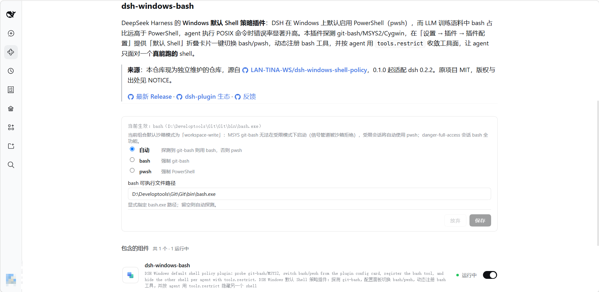
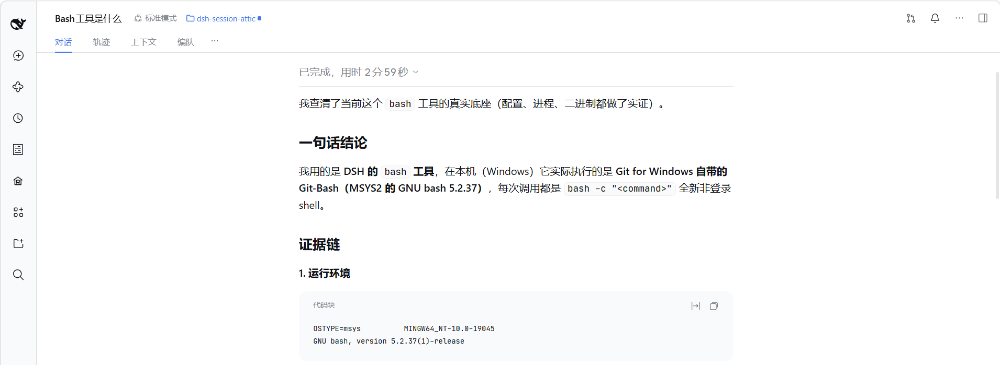

# dsh-windows-bash — Windows Default Shell Policy Plugin

[中文](README.md) | English



[](https://github.com/qiansanyu/dsh-windows-bash)
[](https://github.com/qiansanyu/dsh-windows-bash/releases/latest)
[](https://github.com/qiansanyu/dsh-windows-bash/releases)
[](https://github.com/qiansanyu/dsh-windows-bash)
[](LICENSE)

## dsh-windows-bash

A **Windows default shell policy plugin** for DeepSeek Harness. DSH enables PowerShell (pwsh) by default on Windows, but bash dominates LLM training corpora, so agents make significantly more errors running POSIX commands through pwsh. This plugin probes for git-bash/MSYS2/Cygwin, adds a collapsible "Default Shell" card under Settings → Plugins → Plugin config to switch between bash and pwsh, dynamically registers the bash tool, and narrows the tool surface per agent with `tools.restrict` so the agent faces exactly one shell tool — the one that actually runs.

> **Provenance**: this repository is now maintained independently, based on [LAN-TINA-WS/dsh-windows-shell-policy](https://github.com/LAN-TINA-WS/dsh-windows-shell-policy) — taken over by [qiansanyu](https://github.com/qiansanyu) after upstream stopped following DSH; 0.1.0 adapts it to dsh 0.2.2. The original project is MIT; copyright and provenance live in [NOTICE](NOTICE).
>
> [Latest Release](https://github.com/qiansanyu/dsh-windows-bash/releases/latest) · [dsh-plugin ecosystem](https://github.com/topics/dsh-plugin) · [Feedback](https://github.com/qiansanyu/dsh-windows-bash/issues)

## Showcase



| Capability | Description |
| --- | --- |
| bash probing | Explicit `bashPath` → common Git install paths (Program Files / x86) → MSYS2 / Cygwin → PATH |
| Config card | Collapsible "Default Shell" card (same chrome as the official Terminal / Agent loop / Web search cards) showing probe status and the effective shell; auto / bash / pwsh radio choice with staged edit + save/discard |
| Policy | `auto` uses bash when found, else pwsh; explicit `bash` / `pwsh` forces that shell; takes effect on the next request |
| bash tool | Dynamically registered when effective=bash (git-bash execution over the subprocess seam, timeout / output truncation / exit-code markers), rendered as a terminal card (click to inspect command, cwd, output and exit status — identical to the official shell tools) |
| Tool surface | per-agent `tools.restrict({deny})` hides the other shell: **both the schema and the execution admission set narrow** (a model that hard-calls the hidden shell gets "unknown"), no longer relying on `system-prompt/assemble`; confined sessions fall back to pwsh |
| Persistence | `preferred` is stored in the settings document `shell-policy` section and survives restarts |
| Clean uninstall | `dsh plugin --profile web remove` or `dev_uninject_plugin` restores everything (tool unregistered, prompt restored, junction removed) |

## Quick Install

**GitHub direct install (recommended, fastest in CN, no npm wait)**:

```sh
dsh plugin --profile web add github:qiansanyu/dsh-windows-bash
# restart dsh web, open Settings → Plugins → Plugin config
```

**npm**: this repository publishes as `dsh-windows-bash` (the `dsh-windows-shell-policy` package on npm is the upstream legacy 0.0.7, predating the dsh 0.2.2 adaptation — don't confuse them). Once the npm channel is live, install with `npm i -g dsh-windows-bash`; until then prefer the GitHub direct install or the Release ZIP above.

**Release ZIP install**:

1. Download `dsh-windows-bash-v*.zip` from [Releases](https://github.com/qiansanyu/dsh-windows-bash/releases/latest) and unzip
2. `dsh plugin --profile web add link:<unzipped dir>`
3. Restart `dsh web`, open Settings → Plugins → Plugin config

**Injector install (no restart, dev environments)**:

```sh
DSH_CHECKOUT=<checkout> bash scripts/build.sh   # produces lib/index.js + lib/client.js
dev_inject_plugin <this dir>                   # host+UI take effect immediately
```

## Configuration Guide

Expand the "Default Shell" card under Settings → Plugins → Plugin config:

| Option | Behavior |
| --- | --- |
| auto | Use bash when git-bash is found, else fall back to pwsh (works out of the box) |
| bash | Force git-bash (falls back to pwsh with a notice when no bash is found) |
| pwsh | Force PowerShell (DSH default behavior) |

Changes take effect on the next request after saving; `preferred` and the bash path persist in the plugin's entry config via the settings service across restarts. The explicit bash path is editable directly on the config card.

## Feedback

Issues, feature requests, usage experience: file at [issue #1 (feedback welcome)](https://github.com/qiansanyu/dsh-windows-bash/issues/1).

## Contributors

| Contributor | Contribution |
| --- | --- |
| [qiansanyu](https://github.com/qiansanyu) | Maintainer (dsh 0.2.2 adaptation and ongoing maintenance from 0.1.0) |
| [LAN-TINA-WS](https://github.com/LAN-TINA-WS) | Original author (all design and implementation up to 0.0.7) |

## License

This project is licensed under the [MIT License](LICENSE). The original work is copyright LAN-TINA-WS; this fork keeps both notices in [LICENSE](LICENSE), and records provenance and scope of changes in [NOTICE](NOTICE).

## Developer Docs

Craft notes (authoring conventions, DSH capability lists, composition promotion log) live in [docs/](docs/):

| Doc | Content |
| --- | --- |
| [conventions.md](docs/conventions.md) | Plugin authoring conventions and failure quick-reference |
| [capabilities-host.md](docs/capabilities-host.md) | DSH Host services/events used by this plugin |
| [capabilities-client.md](docs/capabilities-client.md) | DSH Client slots/services used by this plugin |
| [verification.md](docs/verification.md) | Acceptance criteria: four scenarios + session-log forensics |

Repo layout: `src/` (host + client sources), `scripts/` (build), `docs/` (docs and screenshots), `cordis.patch.yml` (bundle patch assembly).
