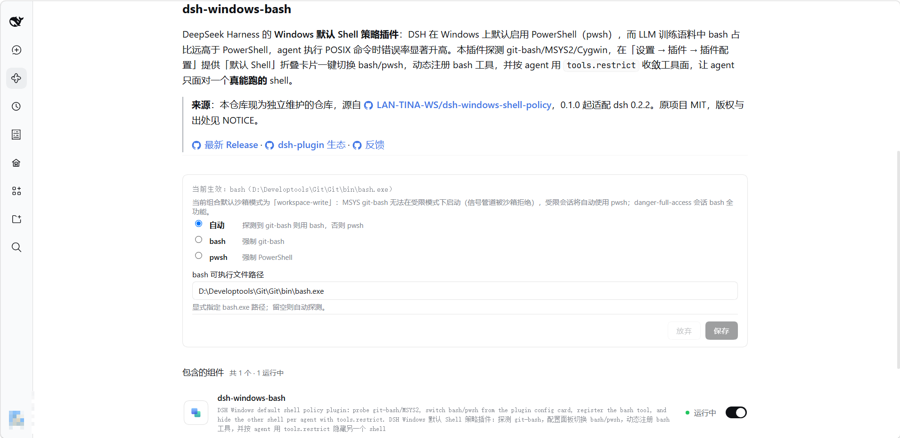
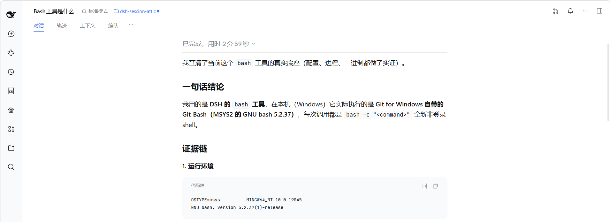

# dsh-windows-bash — Windows 默认 Shell 策略插件

中文 | [English](README.en.md)



[](https://github.com/qiansanyu/dsh-windows-bash)
[](https://github.com/qiansanyu/dsh-windows-bash/releases/latest)
[](https://github.com/qiansanyu/dsh-windows-bash/releases)
[](https://github.com/qiansanyu/dsh-windows-bash)
[](LICENSE)

## dsh-windows-bash

DeepSeek Harness 的 **Windows 默认 Shell 策略插件**：DSH 在 Windows 上默认启用 PowerShell（pwsh），而 LLM 训练语料中 bash 占比远高于 PowerShell，agent 执行 POSIX 命令时错误率显著升高。本插件探测 git-bash/MSYS2/Cygwin，在「设置 → 插件 → 插件配置」提供「默认 Shell」折叠卡片一键切换 bash/pwsh，动态注册 bash 工具，并按 agent 用 `tools.restrict` 收敛工具面，让 agent 只面对一个**真能跑的** shell。

> **来源**：本仓库现为独立维护的仓库，源自 [LAN-TINA-WS/dsh-windows-shell-policy](https://github.com/LAN-TINA-WS/dsh-windows-shell-policy)——原作者停止跟进后由 [qiansanyu](https://github.com/qiansanyu) 接手维护，0.1.0 起适配 dsh 0.2.2。原项目 MIT，版权与出处见 [NOTICE](NOTICE)。
>
> [最新 Release](https://github.com/qiansanyu/dsh-windows-bash/releases/latest) · [dsh-plugin 生态](https://github.com/topics/dsh-plugin) · [反馈](https://github.com/qiansanyu/dsh-windows-bash/issues)

## 成品展示



| 能力 | 说明 |
| --- | --- |
| bash 探测 | 显式 `bashPath` → Git 常见安装路径（Program Files / x86）→ MSYS2 / Cygwin → PATH，找到即用 |
| 配置面板 | 「默认 Shell」折叠卡片（与官方「终端 / Agent 循环 / 网页搜索」卡片同构），显示探测状态与当前生效 shell，自动 / bash / pwsh 三选一（staged 编辑 + 保存/放弃，折叠时保留未保存标记） |
| 策略生效 | `auto` 时探测到 bash 则用 bash 否则 pwsh；显式 `bash` / `pwsh` 强制对应 shell；切换下一次请求生效 |
| bash 工具 | effective=bash 时动态注册（git-bash 执行，subprocess 通道，超时 / 输出截断 / exit code 标记），终端卡片展示（对话页可点击查看命令、cwd、输出与 exit 状态，与官方 shell 工具一致） |
| 工具面收敛 | per-agent `tools.restrict({deny})` 隐藏另一个 shell：**schema 与执行准入同时收窄**（模型硬调被隐藏的 shell 会被判 unknown），不再依赖 `system-prompt/assemble`；confined 会话自动回落 pwsh |
| 持久化 | `preferred` 写入 settings 文档 `shell-policy` section，重启保留 |
| 卸载即净 | `dsh plugin --profile web remove` 或 `dev_uninject_plugin` 一键还原（工具注销 + 提示词恢复 + junction 清理） |

## 快速安装

**GitHub 直装（推荐，国内网络最快，免等 npm）**：

```sh
dsh plugin --profile web add github:qiansanyu/dsh-windows-bash
# 重启 dsh web，打开「设置 → 插件 → 插件配置」开始配置
```

**npm 安装**：本仓库以新包名 `dsh-windows-bash` 发布 npm（npm 上的 `dsh-windows-shell-policy` 是上游旧包 0.0.7，不含 dsh 0.2.2 适配，勿混淆）。npm 发布通道就绪后安装命令为 `npm i -g dsh-windows-bash`；当前请优先使用上方 GitHub 直装或 Release ZIP。

**Release ZIP 安装**：

1. 从 [Releases](https://github.com/qiansanyu/dsh-windows-bash/releases/latest) 下载 `dsh-windows-bash-v*.zip` 并解压
2. `dsh plugin --profile web add link:<解压目录>`
3. 重启 `dsh web`，打开「设置 → 插件 → 插件配置」开始配置

**注入器安装（免重启，开发环境）**：

```sh
DSH_CHECKOUT=<checkout> bash scripts/build.sh   # 产出 lib/index.js + lib/client.js
dev_inject_plugin <本目录>                      # host+UI 即时生效
```

## 配置指南

「设置 → 插件 → 插件配置」内展开「默认 Shell」卡片：

| 选项 | 行为 |
| --- | --- |
| 自动 | 探测到 git-bash 则用 bash，否则回落 pwsh（开箱即用） |
| bash | 强制 git-bash（未探测到 bash 时回落 pwsh 并提示） |
| pwsh | 强制 PowerShell（维持 DSH 默认行为） |

切换保存后下一次请求生效；`preferred` 与 bashPath 经 settings 服务持久化于本插件 entry config，重启保留。显式 bash 路径可直接在配置面板编辑。

## 反馈

问题、需求、使用体验：提交到 [issue #1（欢迎反馈）](https://github.com/qiansanyu/dsh-windows-bash/issues/1)。

## 贡献者

| 贡献者 | 贡献 |
| --- | --- |
| [qiansanyu](https://github.com/qiansanyu) | 维护者（0.1.0 起的 dsh 0.2.2 适配与后续维护） |
| [LAN-TINA-WS](https://github.com/LAN-TINA-WS) | 原作者（0.0.7 及之前全部设计与实现） |

## License

本项目采用 [MIT License](LICENSE)。原项目版权归 LAN-TINA-WS 所有，本仓库在其之上修改，二者的版权声明都保留在 [LICENSE](LICENSE) 中，出处与改动范围见 [NOTICE](NOTICE)。

## 开发者文档

开发工艺（编写规范、DSH 能力清单、组合插件转正流程）见 [docs/](docs/)：

| 文档 | 内容 |
| --- | --- |
| [conventions.md](docs/conventions.md) | 插件编写规范与常见失败速查 |
| [capabilities-host.md](docs/capabilities-host.md) | DSH Host 服务/事件清单（本插件用到的） |
| [capabilities-client.md](docs/capabilities-client.md) | DSH Client 槽位/服务清单（本插件用到的） |
| [verification.md](docs/verification.md) | 验收判据：四组场景 + 会话日志取证 |

仓库结构：`src/`（host + client 源码）、`scripts/`（构建）、`docs/`（文档与截图）、`cordis.patch.yml`（bundle patch 装配）。
